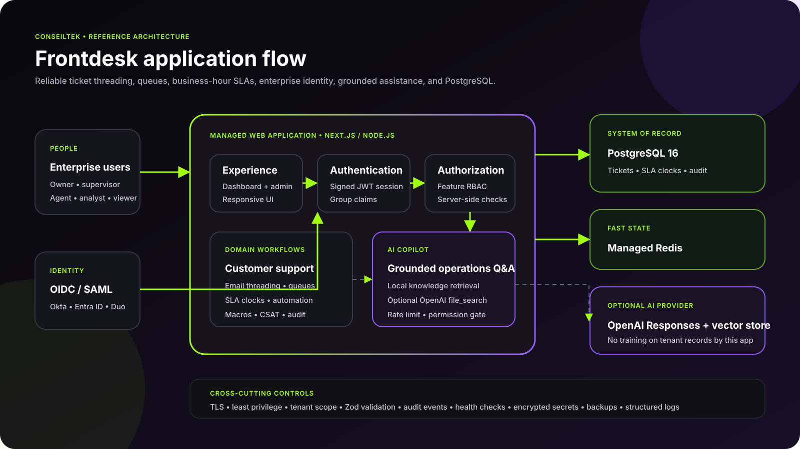
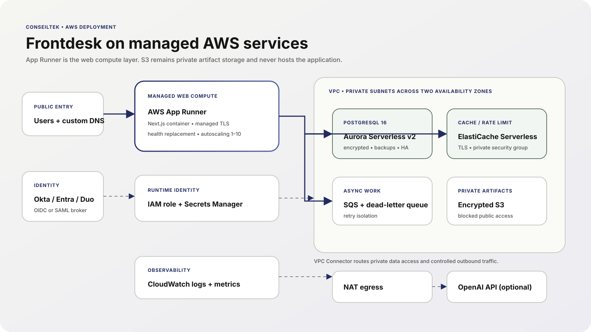
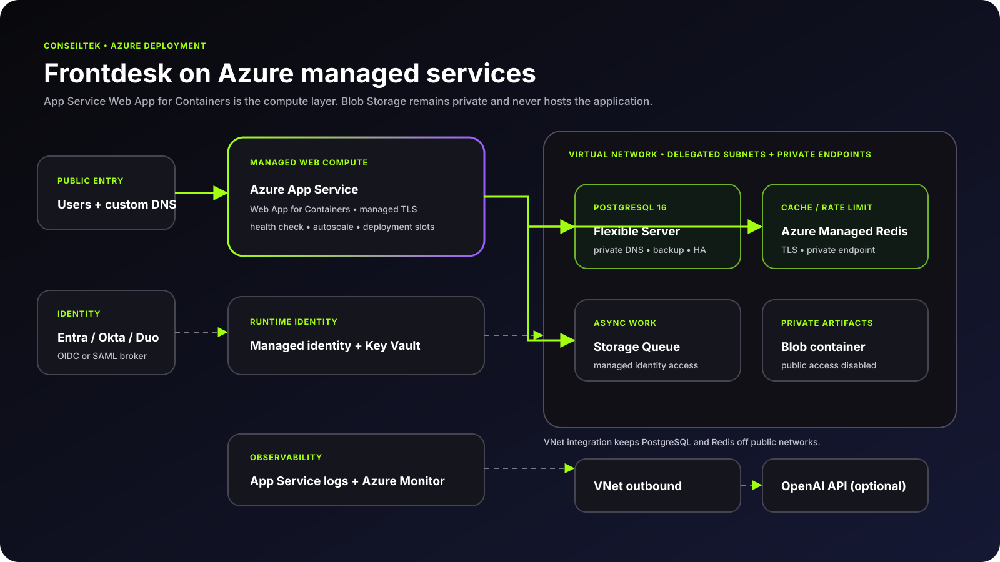

<div align="center">
  
  <h1>Frontdesk</h1>
  <p><strong>Customer support without per-agent software tax.</strong></p>
  <p>Email threading · SLA clocks · queues and macros · enterprise SSO · configurable RBAC · grounded AI</p>
</div>

[](https://github.com/ConseilTek-Tektons/frontdesk/actions/workflows/ci.yml) [](https://github.com/ConseilTek-Tektons/frontdesk/actions/workflows/codeql.yml) [](LICENSE)

Frontdesk brings email, web, API, and chat requests into one auditable ticket model. It threads replies using message headers, routes work into queues, calculates service deadlines against business calendars, and helps agents compose consistent responses. The complete working solution and both cloud deployment paths live in this repository.



## Working capabilities

- Customers, requesters, queues, SLA policies and clocks, tickets, comments, macros, automation, side conversations, CSAT, and audit records
- Header-first email threading and a transaction-backed, permission-checked ticket API
- Configurable roles for owners, administrators, supervisors, agents, light agents, analysts, and viewers
- OIDC for Okta or Microsoft Entra ID; SAML providers including Duo connect through Keycloak or another OIDC broker
- Support copilot grounded in approved procedures and readable ticket context; it can draft but never send
- ConseilTek-branded agent dashboard, working new-ticket interaction, policy editor, health endpoint, and responsive layout
- Docker Compose plus AWS Terraform and Azure Bicep deployment paths

## Run locally

```bash
cp .env.example .env
docker compose up --build
```

Open [http://localhost:3000](http://localhost:3000); Keycloak runs on port 8080. For manual development use `pnpm install`, `pnpm db:migrate`, `pnpm db:seed`, and `pnpm dev`.

## Managed cloud deployment

Frontdesk depends on server-side auth, message processing, PostgreSQL transactions, and AI orchestration. Static website hosting is not a viable application runtime.

| Cloud | Managed web runtime | PostgreSQL | Cache | Deployment |
|---|---|---|---|---|
| AWS | AWS App Runner | Aurora PostgreSQL Serverless v2 | ElastiCache Serverless | [Terraform](infra/aws/README.md) |
| Azure | Azure App Service Web App for Containers | PostgreSQL Flexible Server | Azure Managed Redis | [Bicep](infra/azure/README.md) |

Managed services reduce maintenance for compute replacement, TLS, autoscaling, backups, patching, and cache operation. Queue and object-storage resources support asynchronous processing and attachments while App Runner or App Service hosts the web application.





## Operate and extend

- [Architecture](docs/ARCHITECTURE.md) · [Authentication](docs/AUTHENTICATION.md) · [RBAC](docs/RBAC.md)
- [AI and RAG](docs/AI.md) · [Security](docs/SECURITY.md) · [Operations](docs/OPERATIONS.md)
- Quality gate: `pnpm check`, Terraform validation, Bicep compilation, and an OCI container build

## Ownership

Frontdesk is designed, built, and maintained by [ConseilTek](https://conseiltek.com) and licensed under Apache 2.0. ConseilTek trademarks and supplied brand artwork are not granted by the source-code license. Contact [support@conseiltek.com](mailto:support@conseiltek.com).
