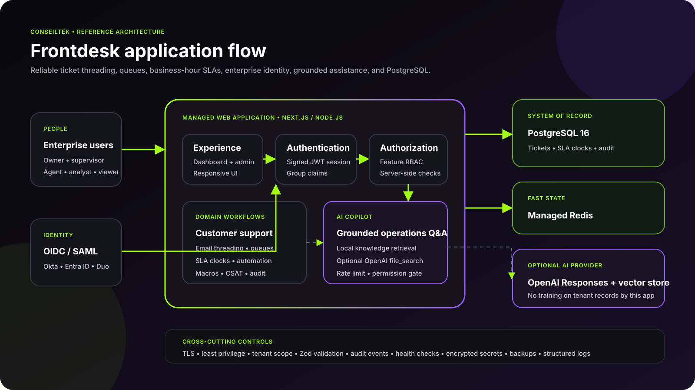

# Frontdesk architecture

Frontdesk is a modular support platform packaged as one portable Next.js container. PostgreSQL owns tickets and timing; Redis supports cross-instance limits; managed queues and private object storage support inbound work, automation, and attachments.

## Request and message flow

1. App Runner or App Service receives authenticated web/API traffic and identity callbacks.
2. Inbound email processing normalizes Message-ID, In-Reply-To, and References. A known reference attaches to that ticket; an unmatched conversation creates a new ticket.
3. Versioned routing evaluates customer, channel, language, tags, and product context before selecting a queue and eligible assignee.
4. The ticket transaction writes the durable record and its audit event. Business-calendar SLA clocks are derived and tracked separately for reproducible reporting.
5. Automation emits idempotent work through the queue; provider callbacks update delivery state without becoming the ticket source of truth.
6. The support copilot sees only permitted ticket context and approved knowledge. A human agent must send every drafted response.

## Bounded modules

| Module | Owns |
|---|---|
| Conversation | ticket, requester, customer, comments, email headers, side conversations |
| Service policy | queues, routing, SLA calendar and clocks, priority |
| Agent workflow | assignment, macros, automation rules and runs |
| Experience | CSAT, analytics, customer and agent views |
| Governance | enterprise identity, feature RBAC, audit, AI controls |

## Invariants

- Message-ID is unique and header evidence wins over subject similarity.
- Callers never submit an organization identifier; the server derives tenant scope.
- SLA timestamps preserve due, pause, fulfillment, and breach facts.
- AI can draft text but cannot send, assign, reprioritize, or solve a ticket.

The application must run server-side. Managed App Runner/App Service compute and managed PostgreSQL reduce operational maintenance while preserving standard containers and SQL portability.
